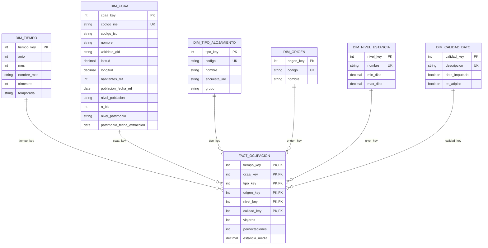
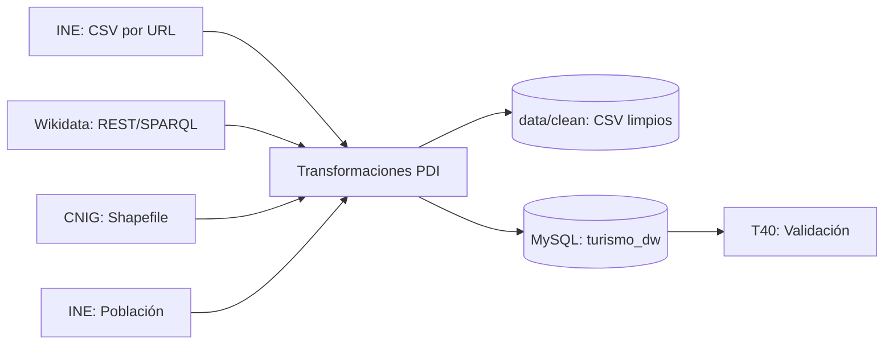

# Turismo en España por Comunidad Autónoma: almacén de datos y ETL

Proyecto de la asignatura **Adquisición y preparación de datos**
Grado en Ingeniería en Inteligencia Artificial · Escuela Politécnica Superior · Universidad de Alicante · Curso 2026-27

**Autores:** _(J, S, P, I)_
**Fecha de entrega:** 11 de diciembre de 2026

---

## Índice

1. [Resumen](#1-resumen)
2. [Apartado 1: Temática, problema y objetivos](#2-apartado-1-temática-problema-y-objetivos)
3. [Apartado 2: Análisis y selección de datos](#3-apartado-2-análisis-y-selección-de-datos)
4. [Apartado 3: Diseño del almacén de datos](#4-apartado-3-diseño-del-almacén-de-datos)
5. [Apartado 4: Extracción, limpieza y carga (Pentaho)](#5-apartado-4-extracción-limpieza-y-carga-pentaho)
6. [Estructura del repositorio](#6-estructura-del-repositorio)
7. [Cómo reproducir el trabajo](#7-cómo-reproducir-el-trabajo)
8. [Estado del proyecto](#8-estado-del-proyecto)
9. [Fuentes y referencias](#9-fuentes-y-referencias)
10. [Licencia](#10-licencia)

---

## 1. Resumen

El proyecto integra estadísticas oficiales de ocupación turística de España (hoteles, apartamentos turísticos, campings y turismo rural), desagregadas por **Comunidad Autónoma (CCAA)** y mes, en un **almacén de datos MySQL**. Los datos se extraen, limpian, transforman y cargan con **Pentaho Data Integration (PDI)** y se enriquecen con **Wikidata** (identificadores, coordenadas y patrimonio cultural) y con los límites administrativos oficiales del **CNIG/IGN**.

El objetivo final es poder comparar la demanda turística entre territorios, relacionarla con la población y con el patrimonio cultural reconocido, publicar los datos como tripletas **schema.org** y visualizarlos en mapas y gráficas.

---

## 2. Apartado 1: Temática, problema y objetivos

### Temática
**Turismo**: demanda y oferta turística en España, analizada de forma comparativa entre Comunidades Autónomas.

### Problema
No existe una visión integrada, actualizada y comparable de cómo se distribuye la demanda turística entre las CCAA, ni de cómo esa distribución se relaciona con el tipo de alojamiento, el perfil del turista (procedencia) y la riqueza patrimonial de cada territorio. Esto dificulta la planificación turística, tanto pública como privada.

### Preguntas de investigación
1. ¿Cómo se distribuye la demanda turística (pernoctaciones, ocupación, estancia media) entre las CCAA y qué papel juega el tipo de alojamiento (hotel, apartamento, camping, turismo rural)?
2. ¿Ha cambiado la composición de la demanda (turista residente en España frente a residente en el extranjero) por CCAA en los últimos años?
3. ¿Las CCAA con más patrimonio cultural reconocido concentran también más demanda turística?

### Lienzo del problema (4W)

| | |
|---|---|
| **Who** | Administraciones turísticas (Ministerio de Industria, Comercio y Turismo y consejerías autonómicas), sector empresarial (hoteles, apartamentos, campings, turismo rural), investigadores y analistas, turistas y ciudadanía |
| **What** | No existe una herramienta abierta y unificada que permita comparar la evolución de la demanda turística entre CCAA y tipos de alojamiento, ni relacionarla con la oferta cultural de cada territorio |
| **Where** | España, por Comunidad Autónoma (17 CCAA + Ceuta y Melilla), con un horizonte de aproximadamente los últimos 10 años, según la cobertura real de los datos |
| **Why** | Facilitar la planificación turística y la asignación de recursos (infraestructuras, promoción, desestacionalización); ayudar al sector privado a detectar oportunidades por región y tipo de alojamiento; dar transparencia al fenómeno turístico |

### Objetivos
1. Integrar y homogeneizar en un almacén de datos las principales estadísticas oficiales de ocupación turística (EOH, EOAP, EOAC, EOTR), por CCAA y periodo.
2. Enriquecer los datos con información semántica y geográfica externa (Wikidata, CNIG).
3. Representar los datos con el vocabulario schema.org para facilitar su reutilización.
4. Generar visualizaciones que respondan a las preguntas de investigación.

### Casos de uso
1. Un técnico de una consejería de turismo consulta la evolución de pernoctaciones de su CCAA por tipo de alojamiento para justificar una campaña de promoción fuera de temporada alta.
2. Una empresa hotelera analiza en qué CCAA ha crecido más la demanda de apartamentos o turismo rural para valorar una expansión.
3. Un ciudadano o periodista de datos compara, en un mapa interactivo, qué comunidades reciben más turismo en relación con su patrimonio cultural.
4. Un tercero reutiliza las tripletas schema.org publicadas en otro proyecto de datos abiertos.

### Métricas clave
- Nº de pernoctaciones y viajeros (totales y por tipo de alojamiento), por CCAA y periodo.
- Estancia media (días) por CCAA.
- Grado de ocupación (%) por CCAA y tipo de alojamiento.
- % de viajeros residentes en España frente a residentes en el extranjero, por CCAA.
- Nº de Bienes de Interés Cultural (BIC) por CCAA, como indicador de oferta cultural.
- Pernoctaciones por habitante (con la población de referencia de cada CCAA).
- % de registros sin valores perdidos tras la limpieza (métrica de calidad del ETL).

---

## 3. Apartado 2: Análisis y selección de datos

### Necesidades de datos

| Necesidad | Tipo | Formato |
|---|---|---|
| Viajeros, pernoctaciones y estancia media (P1) | Cuantitativo, serie temporal mensual | CSV / JSON |
| Procedencia del viajero: residente en España o en el extranjero (P2) | Categórico | CSV / JSON |
| Tipo de alojamiento (P1) | Categórico (determinado por la encuesta de origen) | CSV / JSON |
| Patrimonio cultural por CCAA (P3) | Conteo de entidades enlazadas | SPARQL → JSON/CSV |
| Población por CCAA (normalización por habitante) | Cuantitativo (valor de referencia más reciente) | CSV |
| Geometría de las CCAA (mapa) | Geoespacial | Shapefile / GeoJSON |

### Requisitos de calidad
- **Oficialidad:** fuente institucional y citable.
- **Granularidad:** CCAA × mes.
- **Cobertura temporal:** al menos 10 años.
- **Homogeneidad:** códigos y nombres de CCAA conciliables entre fuentes (se resuelve en el ETL).
- **Licencia abierta** y reutilizable.
- **Trazabilidad:** identificador de tabla y fecha de descarga documentados.

**Datos ficticios:** no se utilizan. Todos los datos proceden de fuentes reales.

### Fuentes analizadas

| Fuente | Decisión | Motivo |
|---|---|---|
| TData (portal de turismo de la UA) | Descartada | Servidor no disponible durante un periodo prolongado, riesgo para la entrega |
| Portales de datos abiertos regionales (GVA, Ayuntamiento de Alicante) | Descartadas | Cobertura regional, no comparable entre todas las CCAA |
| **INE** | **Elegida** | Oficial, estable, CCAA homogéneas, descarga CSV y API |
| **Wikidata** | **Elegida** | Enriquecimiento semántico y geográfico (requisito del apartado 5) |
| **CNIG / IGN** | **Elegida** | Límites administrativos oficiales para el mapa |

> El enfoque inicial se centraba en Alicante. Se amplió a todas las CCAA para trabajar con fuentes oficiales, estables y comparables.

### Datasets seleccionados

| ID | Dataset | Pregunta | Enlace |
|---|---|---|---|
| D1 | Encuesta de Ocupación Hotelera (EOH): viajeros y pernoctaciones por CCAA y provincias · API 67190 | P1, P2 | [INE t=67190](https://www.ine.es/jaxiT3/Tabla.htm?t=67190) · [catálogo datos.gob.es](https://datos.gob.es/es/catalogo/ea0042823-viajeros-y-pernoctaciones-por-comunidades-autonomas-y-provincias-eoh-identificador-api-67190) |
| D2 | Encuesta de Ocupación en Apartamentos Turísticos (EOAP): viajeros y pernoctaciones por CCAA · API 67191 | P1, P2 | [INE t=67191](https://www.ine.es/jaxiT3/Tabla.htm?t=67191) · [catálogo](https://datos.gob.es/gl/catalogo/ea0042823-viajeros-y-pernoctaciones-por-comunidades-autonomas-eoap-identificador-api-67191) |
| D3 | Encuesta de Ocupación en Campings (EOAC): viajeros y pernoctaciones por CCAA · API 67192 | P1, P2 | [INE t=67192](https://www.ine.es/jaxiT3/Tabla.htm?t=67192) · [catálogo](https://datos.gob.es/gl/catalogo/ea0042823-viajeros-y-pernoctaciones-por-comunidades-autonomas-eoac-identificador-api-67192) |
| D4 | Encuesta de Ocupación en Alojamientos de Turismo Rural (EOTR): viajeros y pernoctaciones por CCAA · API 67193 | P1, P2 | [INE t=67193](https://www.ine.es/jaxiT3/Tabla.htm?t=67193) · [catálogo](https://datos.gob.es/es/catalogo/ea0042823-viajeros-y-pernoctaciones-por-comunidades-y-ciudades-autonomas-eotr-identificador-api-67193) |
| D5 | Estadística Continua de Población (ECP): población residente por fecha, sexo, nacionalidad y lugar de nacimiento, CCAA y ciudades autónomas · API 56944 (alternativa: API 59238, por fecha, sexo y edad) | per cápita | [Catálogo datos.gob.es](https://datos.gob.es/en/catalogo/ea0042823-poblacion-residente-por-fecha-sexo-nacionalidad-agrupacion-de-paises-y-lugar-de-nacimiento-agrupacion-de-paises-ecp-identificador-api-56944) · [Metadatos de la operación](https://ine.es/dynt3/metadatos/es/RespuestaDatos.html?oe=30282) |
| D6 | Límites administrativos de las CCAA (CNIG/IGN) | mapa | [Centro de Descargas CNIG](https://centrodedescargas.cnig.es/CentroDescargas/index.jsp) · [WFS INSPIRE](https://www.ign.es/wfs-inspire/unidades-administrativas?request=GetCapabilities&service=WFS) |
| D7 | CCAA y Bienes de Interés Cultural en Wikidata | P3 | [Wikidata Query Service](https://query.wikidata.org/) · [endpoint SPARQL](https://query.wikidata.org/sparql) |

Punto de entrada a todas las estadísticas de turismo del INE: [INEbase, Hostelería y turismo](https://www.ine.es/dyngs/INEbase/es/categoria.htm?c=Estadistica_P&cid=1254735576863).

### Cómo obtener los datos

Los ficheros descargados se guardan en `data/raw/`. Las descargas automáticas (INE y Wikidata) se hacen con un único script y dejan un registro con URL, fecha, tamaño y huella SHA-256 en `data/raw/_descargas.log.csv`:

```bash
python scripts/descargar_fuentes.py              # ocupación y población (INE) + Wikidata
python scripts/descargar_fuentes.py --solo ine   # también: poblacion, ccaa, bic
python scripts/descargar_fuentes.py --dry-run    # solo muestra las URL y consultas
```

El script no repite lo que ya está descargado (`--forzar` para repetirlo). Wikidata limita las peticiones, así que la consulta de patrimonio se hace por lotes con una pausa de un minuto entre ellos y, si se interrumpe, al volver a ejecutarla continúa donde lo dejó.

**INE (D1 a D4).** Cada tabla se descarga por su identificador de API. Formato: CSV separado por `;`, decimales con coma, UTF-8 (con BOM al inicio) y una fila por valor.

| Acceso | Patrón |
|---|---|
| CSV (API de INEbase) | `https://ine.es/wstempus/csv_sc/es/DATOS_TABLA/{ID}` |
| CSV (descarga de la tabla) | `https://www.ine.es/jaxiT3/files/t/csv_bdsc/{ID}.csv` |
| JSON | `https://servicios.ine.es/wstempus/js/ES/DATOS_TABLA/{ID}` |
| Vista web | `https://www.ine.es/jaxiT3/Tabla.htm?t={ID}` o, para tablas del sistema anterior, `https://www.ine.es/jaxi/Tabla.htm?tpx={ID}` |

**INE, población (D5).** La tabla 56944 se descarga con el script (`--solo poblacion`) y se guarda comprimida en `.zip` (unos 82 MB sin comprimir). Columnas: `Sexo; Comunidades y ciudades autónomas; Nacionalidad; País de Nacimiento; Periodo; Total`. Los periodos son trimestrales y están escritos en texto (`1 de enero de 2025`, `1 de octubre de 2024`). La población total de cada territorio es la fila con Sexo, Nacionalidad y País de Nacimiento iguales a "Total"; de ellas se conserva la de **1 de enero más reciente** como población de referencia. En Pentaho, *Text file input* lee el fichero comprimido (pestaña *Content*, desplegable *Compression*). Para descomprimirlo a mano: `unzip data/raw/ine_56944_*.zip -d data/raw/`. Alternativa manual: la tabla 59238 (por sexo y edad) desde la vista web (`https://www.ine.es/jaxiT3/Tabla.htm?t=59238`), seleccionando todas las CCAA, sexo **Total**, edad **Todas las edades** y los periodos de 1 de enero, en formato **CSV separado por ;**.

**CNIG (D6).** En el [Centro de Descargas](https://centrodedescargas.cnig.es/CentroDescargas/index.jsp), producto *Límites municipales, provinciales y autonómicos*, se descarga **Límites y Unidades Administrativas Actuales (Shapefile)**, que contiene la Base de Datos de Divisiones Administrativas de España. Del zip solo se usan las dos capas de recintos autonómicos, que se copian a `data/raw/cnig/`:

| Carpeta del zip | Cobertura | Sistema |
|---|---|---|
| `SHP_ETRS89/recintos_autonomicas_inspire_peninbal_etrs89` | Península, Baleares, Ceuta y Melilla | ETRS89, coordenadas geográficas |
| `SHP_WGS84/recintos_autonomicas_inspire_canarias_wgs84` | Canarias | REGCAN95 (compatible con WGS84), coordenadas geográficas |

Atributos relevantes: `NAMEUNIT` (nombre), `NATCODE` (código nacional), `CODNUT1`-`CODNUT3` (regiones NUTS) y `NATLEVNAME`. Ambas capas están en longitud/latitud compatibles con WGS84, por lo que no se reproyectan. El zip original (unos 157 MB) no se incluye en el repositorio por superar el límite de GitHub. El script `scripts/preparar_geometrias.py` (requiere `pip install pyshp shapely`) une las dos capas, asigna a cada CCAA su código INE, simplifica la geometría y genera `data/clean/ccaa.geojson`, que usan el ETL y las visualizaciones. El shapefile incluye un recinto adicional (*Territorios no asociados a ninguna autonomía*) que el script descarta; el GeoJSON resultante tiene 19 entidades y pesa 1,1 MB.

**Wikidata (D7).** Las dos consultas siguientes se ejecutan en el [Wikidata Query Service](https://query.wikidata.org/) (botón *Download → CSV file* sobre los resultados) o con el script. Se identifican las CCAA por su código ISO 3166-2, de modo que incluyen también Ceuta y Melilla.

```sparql
# CCAA con QID, código ISO y coordenadas (19 filas)
SELECT ?ccaa ?ccaaLabel ?iso ?coord WHERE {
  VALUES ?iso { "ES-AN" "ES-AR" "ES-AS" "ES-IB" "ES-CN" "ES-CB" "ES-CL" "ES-CM" "ES-CT" "ES-VC"
                "ES-EX" "ES-GA" "ES-MD" "ES-MC" "ES-NC" "ES-PV" "ES-RI" "ES-CE" "ES-ML" }
  ?ccaa wdt:P300 ?iso ;
        wdt:P17 wd:Q29 .
  OPTIONAL { ?ccaa wdt:P625 ?coord . }
  SERVICE wikibase:label { bd:serviceParam wikibase:language "es,en". }
}
ORDER BY ?iso
```

```sparql
# Nº de Bienes de Interés Cultural por CCAA (se ejecuta por lotes de pocas CCAA para evitar el tiempo máximo de consulta)
SELECT ?iso ?ccaaLabel (COUNT(DISTINCT ?bien) AS ?n_bic) WHERE {
  VALUES ?iso { "ES-AN" "ES-AR" "ES-AS" "ES-IB" }
  ?ccaa wdt:P300 ?iso ;
        wdt:P17 wd:Q29 .
  ?bien wdt:P808 ?codigo_bic ;
        wdt:P131/wdt:P131?/wdt:P131?/wdt:P131? ?ccaa .
  SERVICE wikibase:label { bd:serviceParam wikibase:language "es,en". }
}
GROUP BY ?iso ?ccaaLabel
ORDER BY ?iso
```

**Qué contienen los ficheros de Wikidata.**
- `wikidata_ccaa.csv` (19 filas) es la ficha de identidad de cada territorio: URI de Wikidata, etiqueta, código ISO y coordenadas de un punto representativo. Enriquece `dim_ccaa` y permite enlazar cada CCAA con `owl:sameAs` en el apartado 5.
- `wikidata_bic_por_ccaa.csv` (19 filas) es un recuento agregado: nº de elementos de Wikidata con código BIC en cada CCAA (12.967 en total). Es un indicador, no el listado de bienes, y depende de la cobertura de Wikidata en cada región; por eso se interpreta como indicador relativo entre territorios y no como registro oficial. No se ha encontrado una fuente nacional abierta y homogénea del registro de BIC por CCAA; los portales autonómicos publican cada uno su propio formato.

Las coordenadas llegan en formato WKT, `Point(longitud latitud)`, y se separan en el ETL. Alternativa para el patrimonio: OpenStreetMap con la etiqueta [`ref:bic`](https://wiki.openstreetmap.org/wiki/Key:ref:bic) mediante [Overpass Turbo](https://overpass-turbo.eu/).

**Tabla de códigos de CCAA.** `data/raw/ccaa_codigos.csv` contiene el código INE, el código ISO, el nombre oficial y el nombre tal y como lo escribe el INE en sus tablas (por ejemplo `Madrid, Comunidad de`). Es la tabla de conciliación entre fuentes que usa el ETL.

CCAA con su código INE y su código ISO 3166-2:

| INE | CCAA | ISO | INE | CCAA | ISO |
|---|---|---|---|---|---|
| 01 | Andalucía | ES-AN | 11 | Extremadura | ES-EX |
| 02 | Aragón | ES-AR | 12 | Galicia | ES-GA |
| 03 | Principado de Asturias | ES-AS | 13 | Comunidad de Madrid | ES-MD |
| 04 | Illes Balears | ES-IB | 14 | Región de Murcia | ES-MC |
| 05 | Canarias | ES-CN | 15 | Comunidad Foral de Navarra | ES-NC |
| 06 | Cantabria | ES-CB | 16 | País Vasco | ES-PV |
| 07 | Castilla y León | ES-CL | 17 | La Rioja | ES-RI |
| 08 | Castilla-La Mancha | ES-CM | 18 | Ceuta | ES-CE |
| 09 | Cataluña | ES-CT | 19 | Melilla | ES-ML |
| 10 | Comunitat Valenciana | ES-VC | | | |

### Inventario de datos descargados (`data/raw/` y `data/clean/`)

| Fichero | Contenido | Tamaño |
|---|---|---|
| `ine_67190_eoh_…csv` | EOH: 70 territorios (nacional, 19 CCAA y 50 provincias) × 2 conceptos × 3 tipos de residencia × 333 meses (1999M01–2026M09) | 139.860 filas, 13 MB |
| `ine_67191_eoap_…csv` | EOAP: apartamentos turísticos, misma estructura sin provincias (hasta 2026M08) | 38.400 filas, 3 MB |
| `ine_67192_eoac_…csv`, `ine_67193_eotr_…csv` | EOAC (campings) y EOTR (turismo rural), misma estructura | 3 MB cada uno |
| `ine_56944_ecp_…zip` | Población residente por CCAA, sexo, nacionalidad y país de nacimiento, trimestral | 82 MB sin comprimir |
| `wikidata_ccaa.csv` | Identidad y coordenadas de las 19 CCAA | 19 filas |
| `wikidata_bic_por_ccaa.csv` | Nº de BIC en Wikidata por CCAA | 19 filas |
| `ccaa_codigos.csv` | Códigos INE e ISO y nombre de cada CCAA tal y como lo escribe el INE | 19 filas |
| `cnig/…recintos_autonomicas…` | Shapefiles de CCAA (Península y Baleares, Ceuta y Melilla; Canarias) | pocos MB |
| `data/clean/ccaa.geojson` | Geometría de las 19 CCAA, simplificada | 1,1 MB |

---

## 4. Apartado 3: Diseño del almacén de datos

Modelo en **estrella**: una única tabla de hechos (`fact_ocupacion`) que contiene solo claves ajenas y medidas numéricas, rodeada de seis dimensiones con los atributos descriptivos y categóricos.

### Diseño conceptual
- **Hecho:** ocupación turística, observada cada mes para un territorio, un tipo de alojamiento y un origen del viajero.
- **Medidas:** viajeros, pernoctaciones y estancia media.
- **Dimensiones:** Tiempo, Territorio (CCAA), Tipo de alojamiento, Origen del viajero, Nivel de estancia y Calidad del dato.
- **Contexto del territorio:** la población y el patrimonio cultural describen a cada CCAA y forman parte de la dimensión Territorio.

### Diseño lógico

Diagrama editable en `docs/diseno_logico.drawio` (draw.io).



| Tabla | Grano | Contenido |
|---|---|---|
| `fact_ocupacion` | mes × CCAA × tipo de alojamiento × origen | Claves ajenas a las seis dimensiones y tres medidas: `viajeros`, `pernoctaciones` y `estancia_media` (derivada) |
| `dim_tiempo` | mes | Año, mes, trimestre y temporada |
| `dim_ccaa` | CCAA (19 filas) | Códigos INE e ISO, QID de Wikidata, coordenadas, población de referencia y su categoría, nº de BIC y su categoría |
| `dim_tipo_alojamiento` | tipo | Hotel, Apartamento, Camping, Turismo rural (con su encuesta INE y grupo hotelero/extrahotelero) |
| `dim_origen` | origen | Residentes en España y Residentes en el extranjero |
| `dim_nivel_estancia` | nivel | Corta, Media, Larga y Sin dato, con sus rangos en días |
| `dim_calidad_dato` | combinación de marcas | Dato original, Dato imputado, Valor atípico, Imputado y atípico |

### Diseño físico
Script de creación: [`sql/01_crear_almacen_turismo.sql`](sql/01_crear_almacen_turismo.sql). Modelo de MySQL Workbench: `docs/almacen_turismo.mwb`.

- Motor InnoDB, codificación `utf8mb4`.
- Clave primaria de la tabla de hechos compuesta por las seis claves de dimensión (cada dimensión conectada aporta una PK/FK, como en la convención de clase), más una restricción `UNIQUE` sobre las cuatro claves que definen el grano (mes, CCAA, tipo y origen). `nivel_key` y `calidad_key` dependen de esas cuatro, así que el `UNIQUE` impide que un mismo grano se cargue dos veces con distinta categoría.
- Claves naturales únicas (`codigo_ine`, `codigo`, `anio + mes`) para que el ETL pueda localizar las claves de cada dimensión.
- Las dimensiones pequeñas (tipo de alojamiento, origen, nivel de estancia y calidad del dato) se cargan en el propio script; `dim_tiempo` y `dim_ccaa` se cargan desde Pentaho.
- Miembro "Sin dato" en `dim_nivel_estancia` (clave 4, valor por defecto) para que la tabla de hechos no tenga claves nulas.
- Vista `v_ocupacion_total`: viajeros y pernoctaciones totales por mes, CCAA y tipo (suma de residentes en España y en el extranjero).
- Vista `v_ocupacion_anual_ccaa`: pernoctaciones por habitante y año.

### Justificación del diseño: por qué una única tabla de hechos

**1. Criterio para separar medidas y atributos.** Una medida es un valor numérico que cambia con la frecuencia con la que se observa el hecho (aquí, cada mes). Lo demás describe a las entidades y va en dimensiones.

| Dato | ¿Cambia cada mes? | Clasificación |
|---|---|---|
| Viajeros, pernoctaciones, estancia media | Sí | **Medidas** de la tabla de hechos |
| Población de la CCAA | No: se actualiza una vez al año y describe al territorio | Atributo de `dim_ccaa` (valor de referencia + categoría) |
| Nº de BIC | No: es una instantánea que casi no varía | Atributo de `dim_ccaa` (valor + categoría) |
| Nivel de estancia, calidad del dato, temporada, tipo de alojamiento, origen | No: son categorías | Dimensiones |

**2. Evita mezclar granos.** La ocupación es mensual, la población anual y el patrimonio una instantánea. Guardar todo en la misma tabla de hechos obligaría a repetir la población y el patrimonio en cada fila, y cualquier suma daría resultados erróneos. Convertir esos datos en descriptores de la CCAA elimina el problema de raíz.

**3. Esquema en estrella clásico, simple y rápido de consultar.** Las tres preguntas de investigación se responden con una sola tabla de hechos y joins directos contra sus dimensiones, sin combinar varias tablas de hechos entre sí:

```sql
-- P1: pernoctaciones por año, CCAA y tipo de alojamiento
SELECT t.anio, c.nombre AS ccaa, a.nombre AS tipo, SUM(f.pernoctaciones) AS pernoctaciones
FROM fact_ocupacion f
JOIN dim_tiempo t ON t.tiempo_key = f.tiempo_key
JOIN dim_ccaa c ON c.ccaa_key = f.ccaa_key
JOIN dim_tipo_alojamiento a ON a.tipo_key = f.tipo_key
GROUP BY t.anio, c.nombre, a.nombre;

-- P2: % de pernoctaciones de residentes en el extranjero
SELECT t.anio, c.nombre AS ccaa,
       ROUND(100 * SUM(CASE WHEN o.codigo = 'EXT' THEN f.pernoctaciones END) / SUM(f.pernoctaciones), 1) AS pct_extranjero
FROM fact_ocupacion f
JOIN dim_tiempo t ON t.tiempo_key = f.tiempo_key
JOIN dim_ccaa c ON c.ccaa_key = f.ccaa_key
JOIN dim_origen o ON o.origen_key = f.origen_key
WHERE o.codigo IN ('ESP', 'EXT')
GROUP BY t.anio, c.nombre;

-- P3: patrimonio frente a demanda
SELECT c.nombre, c.n_bic, c.nivel_patrimonio, SUM(v.pernoctaciones) AS pernoctaciones
FROM v_ocupacion_total v
JOIN dim_ccaa c ON c.ccaa_key = v.ccaa_key
GROUP BY c.nombre, c.n_bic, c.nivel_patrimonio;
```

**4. ETL más sencillo y robusto.** Hay una sola transformación de hechos, parametrizada y reutilizada para las cuatro encuestas. La población (82 MB en origen) y el patrimonio quedan reducidos a 19 valores que se incorporan a `dim_ccaa` en una única transformación.

**5. La tabla de hechos solo contiene claves y números.** Las categorías derivadas de la limpieza (`nivel_estancia` y las marcas de imputación y atípicos) se llevan a dimensiones pequeñas, de modo que los hechos quedan limpios y la discretización se hace una sola vez.

**Alternativa estudiada y descartada: constelación de hechos.** Consistía en añadir `fact_poblacion` y `fact_patrimonio`. Es un modelo válido cuando hay procesos con granos distintos, pero aquí aportaba poco: el patrimonio no es un hecho (no varía con el tiempo) y la población solo añadiría unas 500 filas, a costa de más tablas, más transformaciones de carga y consultas que combinan varias tablas de hechos.

**Limitación asumida.** El indicador por habitante usa la población de referencia más reciente. Esto hace comparables a los territorios y evita que el cambio demográfico se mezcle con la evolución del turismo, pero no usa la población exacta de cada año. Si hiciera falta, se añadiría una tabla de hechos de población anual sin modificar el resto del modelo, porque las dimensiones ya son compartibles.

### Decisiones de diseño
- **Clave de tiempo `AAAAMM`:** sencilla, legible y ordenable.
- **Tipo de alojamiento como dimensión:** lo determina la encuesta de origen (EOH, EOAP, EOAC, EOTR), por lo que se añade como columna durante el ETL.
- **Origen del viajero:** las tablas del INE traen tres combinaciones de residencia (total, residentes en España y residentes en el extranjero). Se cargan solo `ESP` y `EXT`, el nivel más bajo, para que las medidas sean aditivas. El total del INE no se almacena: se usa como control en el ETL (total = ESP + EXT) y para recuperar un componente ausente.
- **Patrimonio (BIC):** `n_bic` cuenta los elementos de Wikidata con código BIC situados en cada CCAA (a través de su cadena de localización administrativa, de hasta cuatro niveles). Depende de la cobertura de Wikidata, por lo que no coincide con el registro oficial y se interpreta como indicador relativo entre territorios.
- **Clave primaria de la tabla de hechos:** incluye las seis claves de dimensión. Estrictamente, la clave mínima sería la de las cuatro dimensiones que definen el grano, pero `nivel_key` y `calidad_key` son categorías derivadas del propio registro; incluirlas en la clave mantiene la convención de que toda clave ajena forma parte de la clave primaria, y el `UNIQUE` sobre el grano conserva la integridad. Las marcas de calidad y el nivel de estancia se calculan antes de la carga, por lo que no se modifican después.
- **Marcar en lugar de borrar:** `dim_calidad_dato` conserva la trazabilidad de cada valor imputado o atípico.
- **Categorías por discretización:** `nivel_estancia` (Corta, Media o Larga; cortes iniciales en 2 y 4 días), `nivel_poblacion` (Muy grande, Grande, Mediana o Pequeña; umbrales de 5, 2 y 1 millón de habitantes) y `nivel_patrimonio` (Alto, Medio o Bajo, por terciles del nº de BIC). Todos son criterios iniciales, revisables con la distribución real.
- **Temporada** (criterio inicial, parametrizable): Alta de junio a septiembre, Media de marzo a mayo y octubre, Baja el resto.

---

## 5. Apartado 4: Extracción, limpieza y carga (Pentaho)

Herramienta: **Pentaho Data Integration (Kettle)**, edición Community. Las transformaciones (`.ktr`) se orquestan desde un job (`.kjb`).

### Arquitectura del flujo



### Transformaciones y job

| Fichero | Función | Pasos principales de PDI |
|---|---|---|
| `T01_dim_tiempo.ktr` | Genera la dimensión tiempo (meses 1999-2030) | Generate rows, Add sequence, Calculator, Value Mapper, Table output |
| `T02_dim_ccaa.ktr` | Dimensión CCAA completa: códigos, Wikidata (QID, coordenadas, BIC) y población de referencia | Data grid (códigos INE/ISO), Text file input / REST client + JSON input (Wikidata), Text file input con compresión Zip (población), Filter rows (Sexo, Nacionalidad y País de Nacimiento = "Total"; periodo del 1 de enero), Split Fields (año), Sort rows y Unique rows (último año por CCAA), Split Fields (coordenadas), Stream lookup, Number range (`nivel_poblacion`, `nivel_patrimonio`), ESRI shapefile reader (contraste de nombres con el CNIG), Table output |
| `T10_eoh.ktr` | Plantilla de carga de ocupación (hoteles) | Text file input (URL), Select values, Filter rows, Split Fields, Replace in string, Stream lookup, Row denormaliser, Calculator, Number range, Database lookup, Unique rows, Table output |
| `T11_eoap.ktr`, `T12_eoac.ktr`, `T13_eotr.ktr` | Copias de T10 con distintos parámetros | `ID_TABLA` y `COD_TIPO` |
| `T40_validacion.ktr` | Controles de calidad sobre el almacén cargado | Table input, Data Validator, Abort |
| `J00_carga.kjb` | Orquesta la carga completa | Start → Set variables → T01 y T02 → T10 a T13 → T40 → Success |

**Orden de carga:** primero las dimensiones y después los hechos. PDI ejecuta en paralelo los pasos de una misma transformación y no garantiza el orden, de modo que la secuencia se impone desde el job. Cada tabla tiene un único paso *Table output*.

### Flujo de la plantilla de ocupación (T10)

Parámetros de la transformación: `ID_TABLA` (por ejemplo `67190`) y `COD_TIPO` (`HOT`, `APT`, `CAM` o `RUR`).

1. **Extracción:** *Text file input* con la URL del CSV del INE como nombre de fichero. Codificación UTF-8, separador `;`, configuración regional `es`, decimal `,` y agrupación `.`. El código `..` del INE se define como nulo en la columna *Null if*.
2. **Selección y tipos:** *Select values* renombra columnas y convierte tipos. El primer nombre de columna puede traer la marca BOM del fichero; se corrige aquí.
3. **Filtrado:** se conserva solo el nivel CCAA; se descartan `Total Nacional` y, en la EOH, las provincias, que son redundantes.
4. **Splitting:** el periodo (formato `2026M09`) se separa en `anio` y `mes`.
5. **Normalización de territorios:** los nombres de CCAA tal y como los escribe el INE (`Madrid, Comunidad de`, `Balears, Illes`…) se concilian con `codigo_ine` mediante `ccaa_codigos.csv`.
6. **Origen:** *Value Mapper* sobre `Residencia: Nivel 2`: `Residentes en España` → `ESP`, `Residentes en el Extranjero` → `EXT` y vacío → total (rama de control).
7. **Pivotado:** *Row denormaliser* coloca viajeros y pernoctaciones en columnas.
8. **Control y valores ausentes:** en la rama de control se compara el total con ESP + EXT (*Group by* y *Merge join*). Si un componente falta y el total es conocido, se calcula por diferencia (`calidad_key = 2`); las discrepancias se registran. Solo ESP y EXT continúan hacia la tabla de hechos.
9. **Derivación:** *Calculator* obtiene `estancia_media = pernoctaciones / viajeros`, con control de división por cero.
10. **Binning:** *Number range* clasifica `estancia_media` en Corta, Media o Larga (cortes iniciales en 2 y 4 días, a ajustar con la distribución real) y se obtiene `nivel_key`; si no hay dato, `nivel_key = 4` (Sin dato).
11. **Claves:** *Database lookup* contra `dim_ccaa`, `dim_tipo_alojamiento` y `dim_origen`; `calidad_key` se asigna según el dato sea original, imputado o atípico. Las filas sin clave se desvían a una salida de errores.
12. **Carga:** *Unique rows* y *Table output* hacia `fact_ocupacion`.

### Cumplimiento de las tareas del apartado

| Requisito | Cómo se cubre |
|---|---|
| Conectar con fuentes diversas (BD, ficheros, servicios web) | CSV por URL (INE), REST (Wikidata), Shapefile (CNIG), MySQL (lookups y validación) |
| Fusión de varias fuentes | Stream lookup y Merge join: CCAA + Wikidata; ocupación + población |
| Seleccionar campos, filtrar filas, ordenar | Select values, Filter rows, Sort rows |
| Corregir errores | Trim, Replace in string y normalización de nombres de CCAA |
| Gestionar valores que faltan | `..` → NULL; componente ausente recuperado como total − otro componente; hueco aislado imputado con la media de los meses vecinos (`calidad_key = 2`); huecos largos se mantienen como NULL |
| Eliminar o minimizar la redundancia | Eliminación de totales y provincias, Unique rows y claves naturales únicas |
| Ingeniería de características | **Splitting** (periodo → año y mes), variable derivada `estancia_media`, `temporada`, y **Binning** (`nivel_estancia`, `nivel_poblacion`, `nivel_patrimonio`) |
| Enriquecer datos | Wikidata (QID, coordenadas, BIC), shapefile del CNIG y población |
| Detectar y tratar outliers | Media y desviación por CCAA × tipo (Group by) y z-score (Calculator); se marca el registro (`calidad_key` = 3 o 4) sin eliminarlo |
| Validar datos | Data Validator y comprobaciones SQL en T40 |
| Flujo de trabajo completo | Job `J00_carga.kjb` |

**Tratamiento de outliers.** Los meses de 2020 y 2021 son atípicos por el impacto de la pandemia, pero son datos reales. Se marcan y se conservan.

**Validaciones (T40):**
- Número de filas cargadas frente al origen.
- Coherencia: total del INE = residentes en España + residentes en el extranjero.
- Ausencia de claves huérfanas.
- Valores no negativos.
- `pernoctaciones ≥ viajeros`.
- `estancia_media` dentro de un rango razonable.

> Si alguna tarea resulta inviable en Pentaho, se implementará un script de apoyo en Python justificando la decisión en la memoria.

---

## 6. Estructura del repositorio

```
.
├── README.md
├── LICENSE
├── data/
│   ├── raw/             # descargas originales + ccaa_codigos.csv + registro de descargas
│   └── clean/           # CSV limpios generados por el ETL
├── docs/
│   ├── diseno_logico.drawio
│   ├── almacen_turismo.mwb
│   └── memoria.pdf
├── scripts/
│   ├── descargar_fuentes.py   # descarga INE y Wikidata
│   └── preparar_geometrias.py # shapefiles CNIG → data/clean/ccaa.geojson
├── sql/
│   └── 01_crear_almacen_turismo.sql
├── kettle/
│   ├── T01_dim_tiempo.ktr
│   ├── T02_dim_ccaa.ktr
│   ├── T10_eoh.ktr · T11_eoap.ktr · T12_eoac.ktr · T13_eotr.ktr
│   ├── T40_validacion.ktr
│   └── J00_carga.kjb
├── rdf/                 # tripletas schema.org (apartado 5)
└── visualizaciones/     # mapas y gráficas (apartado 6)
```

---

## 7. Cómo reproducir el trabajo

**Requisitos:**
- [Pentaho Data Integration (Community Edition)](https://pentaho-public.atlassian.net/wiki/spaces/COM/overview?mode=global) y la versión de Java que exija.
- MySQL 8 y MySQL Workbench.
- Python 3.8 o superior. El script de descarga no tiene dependencias; el de geometrías necesita `pip install pyshp shapely`.
- Conector JDBC de MySQL (`mysql-connector-j-*.jar`) copiado en `data-integration/lib` (reiniciar Spoon).

**Pasos:**

1. **Crear el almacén.** Ejecutar `sql/01_crear_almacen_turismo.sql` en MySQL Workbench.
2. **Configurar la conexión en Pentaho.** *View → Database connections → New*: tipo MySQL, acceso Native (JDBC), host `localhost`, puerto `3306`, base de datos `turismo_dw`, usuario y contraseña. Pulsar **Test**.
3. **Obtener los datos**: ejecutar `python scripts/descargar_fuentes.py`, descargar a mano el shapefile del CNIG (copiando las dos capas autonómicas a `data/raw/cnig/`) y ejecutar `python scripts/preparar_geometrias.py`, según la sección [Cómo obtener los datos](#cómo-obtener-los-datos).
4. **Ejecutar el job completo**, desde Spoon o por línea de comandos:

```bash
./kitchen.sh -file=kettle/J00_carga.kjb -level:Basic
```

5. **Comprobar la carga** con los resultados de `T40_validacion.ktr` o con consultas sobre el almacén, por ejemplo:

```sql
SELECT t.anio, c.nombre, SUM(f.pernoctaciones) AS pernoctaciones
FROM v_ocupacion_total f
JOIN dim_tiempo t ON t.tiempo_key = f.tiempo_key
JOIN dim_ccaa   c ON c.ccaa_key   = f.ccaa_key
GROUP BY t.anio, c.nombre
ORDER BY t.anio, pernoctaciones DESC;
```

---

## 8. Estado del proyecto

- [x] **Apartado 1:** temática, problema, 4W, objetivos, casos de uso y métricas
- [x] **Apartado 2:** necesidades de datos, selección y descarga de todos los datasets
- [ ] **Apartado 3:** diseño en estrella y script SQL listos; pendientes el diagrama lógico (draw.io), el modelo de MySQL Workbench (`.mwb`) y la ejecución del script
- [ ] **Apartado 4:** transformaciones y job de Pentaho _(diseño definido, implementación en curso)_
- [ ] **Apartado 5:** transformación a tripletas schema.org y enlace con Wikidata
- [ ] **Apartado 6:** dos visualizaciones (mapa coroplético y evolución temporal)
- [ ] **Apartado 7:** memoria (máximo 10 páginas)
- [ ] **Apartado 8:** repositorio final, licencia y referencias
- [ ] **Exposición y defensa:** 18 de diciembre de 2026 (fecha prevista, pendiente de confirmar)

---

## 9. Fuentes y referencias

**Estadística oficial**
- INE, [Hostelería y turismo (INEbase)](https://www.ine.es/dyngs/INEbase/es/categoria.htm?c=Estadistica_P&cid=1254735576863)
- INE, [Encuesta de Ocupación Hotelera](https://www.ine.es/jaxiT3/Tabla.htm?t=67190) · [Apartamentos](https://www.ine.es/jaxiT3/Tabla.htm?t=67191) · [Campings](https://www.ine.es/jaxiT3/Tabla.htm?t=67192) · [Turismo rural](https://www.ine.es/jaxiT3/Tabla.htm?t=67193)
- INE, [Estadística Continua de Población](https://ine.es/dynt3/metadatos/es/RespuestaDatos.html?oe=30282)
- [datos.gob.es](https://datos.gob.es/): catálogo nacional de datos abiertos

**Cartografía**
- CNIG/IGN, [Centro de Descargas](https://centrodedescargas.cnig.es/CentroDescargas/index.jsp)
- IGN, [WFS INSPIRE de unidades administrativas](https://www.ign.es/wfs-inspire/unidades-administrativas?request=GetCapabilities&service=WFS)

**Datos enlazados y enriquecimiento**
- [Wikidata Query Service](https://query.wikidata.org/)
- [OpenStreetMap, etiqueta `ref:bic`](https://wiki.openstreetmap.org/wiki/Key:ref:bic) y [Overpass Turbo](https://overpass-turbo.eu/)
- [schema.org](https://schema.org/) (vocabulario del apartado 5)

**Herramientas**
- [Pentaho Community Wiki](https://pentaho-public.atlassian.net/wiki/spaces/COM/overview?mode=global)
- [draw.io](https://www.drawio.com/) y [MySQL Workbench](https://www.mysql.com/products/workbench/)

**Material de la asignatura:** enunciado de la práctica y presentaciones de Pentaho (introducción y extracción de datos), Adquisición y preparación de datos, Universidad de Alicante.

---

## 10. Licencia

_(Pendiente de elegir. Por ejemplo, MIT para el código y CC BY 4.0 para la documentación.)_

Los datos proceden de las fuentes citadas en la sección anterior y mantienen las condiciones de uso de cada organismo (INE, CNIG/IGN, Wikidata). Se cita siempre la fuente original.