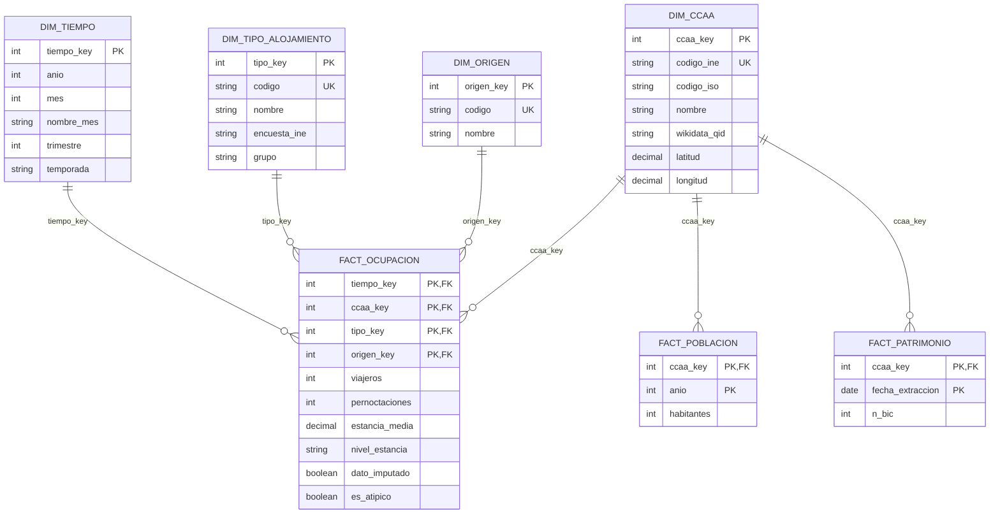
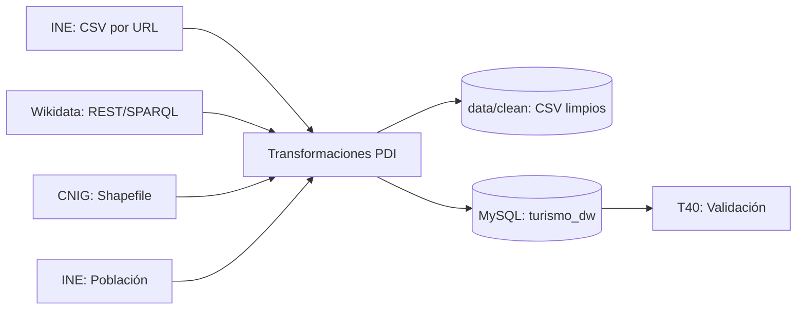

# Turismo en España por Comunidad Autónoma: almacén de datos y ETL

Proyecto de la asignatura **Adquisición y preparación de datos**
Grado en Ingeniería en Inteligencia Artificial · Escuela Politécnica Superior · Universidad de Alicante · Curso 2026-27

**Autores:** _(nombre y apellidos de los 4 integrantes del grupo)_
**Fecha de entrega:** 11 de diciembre de 2026

---

## Índice

1. [Resumen](#1-resumen)
2. [Apartado 1: Temática, problema y objetivos](#2-apartado-1-temática-problema-y-objetivos)
3. [Apartado 2: Análisis y selección de datos](#3-apartado-2-análisis-y-selección-de-datos)
4. [Apartado 3: Diseño del almacén de datos](#4-apartado-3-diseño-del-almacén-de-datos)
5. [Apartado 4: Extracción, limpieza y carga (Pentaho)](#5-apartado-4-extracción-limpieza-y-carga-pentaho)
6. [Estructura del repositorio](#6-estructura-del-repositorio)
7. [Cómo reproducir el trabajo](#7-cómo-reproducir-el-trabajo)
8. [Estado del proyecto](#8-estado-del-proyecto)
9. [Fuentes y referencias](#9-fuentes-y-referencias)
10. [Licencia](#10-licencia)

---

## 1. Resumen

El proyecto integra estadísticas oficiales de ocupación turística de España (hoteles, apartamentos turísticos, campings y turismo rural), desagregadas por **Comunidad Autónoma (CCAA)** y mes, en un **almacén de datos MySQL**. Los datos se extraen, limpian, transforman y cargan con **Pentaho Data Integration (PDI)** y se enriquecen con **Wikidata** (identificadores, coordenadas y patrimonio cultural) y con los límites administrativos oficiales del **CNIG/IGN**.

El objetivo final es poder comparar la demanda turística entre territorios, relacionarla con la población y con el patrimonio cultural reconocido, publicar los datos como tripletas **schema.org** y visualizarlos en mapas y gráficas.

---

## 2. Apartado 1: Temática, problema y objetivos

### Temática
**Turismo**: demanda y oferta turística en España, analizada de forma comparativa entre Comunidades Autónomas.

### Problema
No existe una visión integrada, actualizada y comparable de cómo se distribuye la demanda turística entre las CCAA, ni de cómo esa distribución se relaciona con el tipo de alojamiento, el perfil del turista (procedencia) y la riqueza patrimonial de cada territorio. Esto dificulta la planificación turística, tanto pública como privada.

### Preguntas de investigación
1. ¿Cómo se distribuye la demanda turística (pernoctaciones, ocupación, estancia media) entre las CCAA y qué papel juega el tipo de alojamiento (hotel, apartamento, camping, turismo rural)?
2. ¿Ha cambiado la composición de la demanda (turista residente en España frente a residente en el extranjero) por CCAA en los últimos años?
3. ¿Las CCAA con más patrimonio cultural reconocido concentran también más demanda turística?

### Lienzo del problema (4W)

| | |
|---|---|
| **Who** | Administraciones turísticas (Ministerio de Industria, Comercio y Turismo y consejerías autonómicas), sector empresarial (hoteles, apartamentos, campings, turismo rural), investigadores y analistas, turistas y ciudadanía |
| **What** | No existe una herramienta abierta y unificada que permita comparar la evolución de la demanda turística entre CCAA y tipos de alojamiento, ni relacionarla con la oferta cultural de cada territorio |
| **Where** | España, por Comunidad Autónoma (17 CCAA + Ceuta y Melilla), con un horizonte de aproximadamente los últimos 10 años, según la cobertura real de los datos |
| **Why** | Facilitar la planificación turística y la asignación de recursos (infraestructuras, promoción, desestacionalización); ayudar al sector privado a detectar oportunidades por región y tipo de alojamiento; dar transparencia al fenómeno turístico |

### Objetivos
1. Integrar y homogeneizar en un almacén de datos las principales estadísticas oficiales de ocupación turística (EOH, EOAP, EOAC, EOTR), por CCAA y periodo.
2. Enriquecer los datos con información semántica y geográfica externa (Wikidata, CNIG).
3. Representar los datos con el vocabulario schema.org para facilitar su reutilización.
4. Generar visualizaciones que respondan a las preguntas de investigación.

### Casos de uso
1. Un técnico de una consejería de turismo consulta la evolución de pernoctaciones de su CCAA por tipo de alojamiento para justificar una campaña de promoción fuera de temporada alta.
2. Una empresa hotelera analiza en qué CCAA ha crecido más la demanda de apartamentos o turismo rural para valorar una expansión.
3. Un ciudadano o periodista de datos compara, en un mapa interactivo, qué comunidades reciben más turismo en relación con su patrimonio cultural.
4. Un tercero reutiliza las tripletas schema.org publicadas en otro proyecto de datos abiertos.

### Métricas clave
- Nº de pernoctaciones y viajeros (totales y por tipo de alojamiento), por CCAA y periodo.
- Estancia media (días) por CCAA.
- Grado de ocupación (%) por CCAA y tipo de alojamiento.
- % de viajeros residentes en España frente a residentes en el extranjero, por CCAA.
- Nº de Bienes de Interés Cultural (BIC) por CCAA, como indicador de oferta cultural.
- Pernoctaciones per cápita (con la población de cada CCAA).
- % de registros sin valores perdidos tras la limpieza (métrica de calidad del ETL).

---

## 3. Apartado 2: Análisis y selección de datos

### Necesidades de datos

| Necesidad | Tipo | Formato |
|---|---|---|
| Viajeros, pernoctaciones y estancia media (P1) | Cuantitativo, serie temporal mensual | CSV / JSON |
| Procedencia del viajero: residente en España o en el extranjero (P2) | Categórico | CSV / JSON |
| Tipo de alojamiento (P1) | Categórico (determinado por la encuesta de origen) | CSV / JSON |
| Patrimonio cultural por CCAA (P3) | Conteo de entidades enlazadas | SPARQL → JSON/CSV |
| Población por CCAA (normalización per cápita) | Cuantitativo anual | CSV |
| Geometría de las CCAA (mapa) | Geoespacial | Shapefile / GeoJSON |

### Requisitos de calidad
- **Oficialidad:** fuente institucional y citable.
- **Granularidad:** CCAA × mes.
- **Cobertura temporal:** al menos 10 años.
- **Homogeneidad:** códigos y nombres de CCAA conciliables entre fuentes (se resuelve en el ETL).
- **Licencia abierta** y reutilizable.
- **Trazabilidad:** identificador de tabla y fecha de descarga documentados.

**Datos ficticios:** no se utilizan. Todos los datos proceden de fuentes reales.

### Fuentes analizadas

| Fuente | Decisión | Motivo |
|---|---|---|
| TData (portal de turismo de la UA) | Descartada | Servidor no disponible durante un periodo prolongado, riesgo para la entrega |
| Portales de datos abiertos regionales (GVA, Ayuntamiento de Alicante) | Descartadas | Cobertura regional, no comparable entre todas las CCAA |
| **INE** | **Elegida** | Oficial, estable, CCAA homogéneas, descarga CSV y API |
| **Wikidata** | **Elegida** | Enriquecimiento semántico y geográfico (requisito del apartado 5) |
| **CNIG / IGN** | **Elegida** | Límites administrativos oficiales para el mapa |

> El enfoque inicial se centraba en Alicante. Se amplió a todas las CCAA para trabajar con fuentes oficiales, estables y comparables.

### Datasets seleccionados

| ID | Dataset | Pregunta | Enlace |
|---|---|---|---|
| D1 | Encuesta de Ocupación Hotelera (EOH): viajeros y pernoctaciones por CCAA y provincias · API 67190 | P1, P2 | [INE t=67190](https://www.ine.es/jaxiT3/Tabla.htm?t=67190) · [catálogo datos.gob.es](https://datos.gob.es/es/catalogo/ea0042823-viajeros-y-pernoctaciones-por-comunidades-autonomas-y-provincias-eoh-identificador-api-67190) |
| D2 | Encuesta de Ocupación en Apartamentos Turísticos (EOAP): viajeros y pernoctaciones por CCAA · API 67191 | P1 | [INE t=67191](https://www.ine.es/jaxiT3/Tabla.htm?t=67191) · [catálogo](https://datos.gob.es/gl/catalogo/ea0042823-viajeros-y-pernoctaciones-por-comunidades-autonomas-eoap-identificador-api-67191) |
| D3 | Encuesta de Ocupación en Campings (EOAC): viajeros y pernoctaciones por CCAA · API 67192 | P1 | [INE t=67192](https://www.ine.es/jaxiT3/Tabla.htm?t=67192) · [catálogo](https://datos.gob.es/gl/catalogo/ea0042823-viajeros-y-pernoctaciones-por-comunidades-autonomas-eoac-identificador-api-67192) |
| D4 | Encuesta de Ocupación en Alojamientos de Turismo Rural (EOTR): viajeros y pernoctaciones por CCAA · API 67193 | P1 | [INE t=67193](https://www.ine.es/jaxiT3/Tabla.htm?t=67193) · [catálogo](https://datos.gob.es/es/catalogo/ea0042823-viajeros-y-pernoctaciones-por-comunidades-y-ciudades-autonomas-eotr-identificador-api-67193) |
| D5 | EOH: pernoctaciones por CCAA, país de residencia y mes · API 67179 | P2 | [INE t=67179](https://www.ine.es/jaxiT3/Tabla.htm?t=67179) · [catálogo](https://datos.gob.es/es/catalogo/ea0042823-pernoctaciones-de-los-viajeros-por-comunidades-y-ciudades-autonomas-pais-de-residencia-y-meses-eoh-identificador-api-67179) |
| D5b | Complementos de origen: EOAP por país de residencia (API 59162) y EOTR por procedencia (API 67180) | P2 | [INE t=59162](https://www.ine.es/jaxiT3/Tabla.htm?t=59162) · [INE t=67180](https://www.ine.es/jaxiT3/Tabla.htm?t=67180) |
| D6 | Cifras de Población por CCAA (INE) | per cápita | [Operación Cifras de Población](https://www.ine.es/dynt3/metadatos/es/RespuestaDatos.html?oe=30321) |
| D7 | Límites administrativos de las CCAA (CNIG/IGN) | mapa | [Centro de Descargas CNIG](https://centrodedescargas.cnig.es/CentroDescargas/index.jsp) · [WFS INSPIRE](https://www.ign.es/wfs-inspire/unidades-administrativas?request=GetCapabilities&service=WFS) |
| D8 | CCAA y Bienes de Interés Cultural en Wikidata | P3 | [Wikidata Query Service](https://query.wikidata.org/) · [endpoint SPARQL](https://query.wikidata.org/sparql) |

Punto de entrada a todas las estadísticas de turismo del INE: [INEbase, Hostelería y turismo](https://www.ine.es/dyngs/INEbase/es/categoria.htm?c=Estadistica_P&cid=1254735576863).

### Cómo obtener los datos

**INE (D1 a D6).** Cada tabla se descarga desde su página (botón *Descargar*, CSV separado por `;`) o por URL directa:

| Acceso | Patrón |
|---|---|
| CSV | `https://ine.es/wstempus/csv_sc/es/DATOS_TABLA/{ID}` |
| API JSON | `https://servicios.ine.es/wstempus/js/ES/DATOS_TABLA/{ID}` |

Ejemplo: `https://ine.es/wstempus/csv_sc/es/DATOS_TABLA/67190`. Los ficheros descargados se guardan en `data/raw/` con la fecha de descarga.

**CNIG (D7).** *Información geográfica de referencia → Límites administrativos → Comunidades Autónomas*, formato Shapefile.

**Wikidata (D8).** Consultas SPARQL, exportadas a CSV/JSON o llamadas desde Pentaho con el paso *REST client*.

CCAA con su código INE y su código ISO 3166-2 (clave de conciliación entre fuentes):

| INE | CCAA | ISO | INE | CCAA | ISO |
|---|---|---|---|---|---|
| 01 | Andalucía | ES-AN | 11 | Extremadura | ES-EX |
| 02 | Aragón | ES-AR | 12 | Galicia | ES-GA |
| 03 | Principado de Asturias | ES-AS | 13 | Comunidad de Madrid | ES-MD |
| 04 | Illes Balears | ES-IB | 14 | Región de Murcia | ES-MC |
| 05 | Canarias | ES-CN | 15 | Comunidad Foral de Navarra | ES-NC |
| 06 | Cantabria | ES-CB | 16 | País Vasco | ES-PV |
| 07 | Castilla y León | ES-CL | 17 | La Rioja | ES-RI |
| 08 | Castilla-La Mancha | ES-CM | 18 | Ceuta | ES-CE |
| 09 | Cataluña | ES-CT | 19 | Melilla | ES-ML |
| 10 | Comunitat Valenciana | ES-VC | | | |

Consultas SPARQL de referencia:

```sparql
# CCAA con QID, código ISO y coordenadas
SELECT ?ccaa ?ccaaLabel ?iso ?coord WHERE {
  ?ccaa wdt:P31 wd:Q5852411 .
  OPTIONAL { ?ccaa wdt:P300 ?iso }
  OPTIONAL { ?ccaa wdt:P625 ?coord }
  SERVICE wikibase:label { bd:serviceParam wikibase:language "es,en". }
}
```

```sparql
# Nº de Bienes de Interés Cultural por CCAA
SELECT ?ccaaLabel (COUNT(?bien) AS ?n_bic) WHERE {
  ?ccaa wdt:P31 wd:Q5852411 .
  ?bien wdt:P808 ?codigoBIC ; wdt:P131+ ?ccaa .
  SERVICE wikibase:label { bd:serviceParam wikibase:language "es,en". }
} GROUP BY ?ccaaLabel
```

Alternativa para el patrimonio: OpenStreetMap con la etiqueta [`ref:bic`](https://wiki.openstreetmap.org/wiki/Key:ref:bic) mediante [Overpass Turbo](https://overpass-turbo.eu/).

---

## 4. Apartado 3: Diseño del almacén de datos

Modelo en **constelación de hechos**: tres tablas de hechos que comparten la dimensión territorial.

### Diseño conceptual
- **Hecho principal:** ocupación turística (viajeros, pernoctaciones, estancia media).
- **Dimensiones:** Tiempo, Territorio (CCAA), Tipo de alojamiento, Origen del viajero.
- **Hechos de contexto del territorio:** población y patrimonio cultural.

### Diseño lógico

Diagrama editable en `docs/diseno_logico.drawio` (draw.io).



| Tabla | Grano | Medidas / atributos |
|---|---|---|
| `fact_ocupacion` | mes × CCAA × tipo de alojamiento × origen | viajeros, pernoctaciones, estancia_media (derivada), nivel_estancia (discretizada), indicadores de calidad |
| `fact_poblacion` | CCAA × año | habitantes (a 1 de enero) |
| `fact_patrimonio` | CCAA × fecha de extracción | n_bic (instantánea de Wikidata) |
| `dim_tiempo` | mes | año, mes, trimestre, temporada |
| `dim_ccaa` | CCAA (19 filas) | códigos INE e ISO, QID de Wikidata, latitud, longitud |
| `dim_tipo_alojamiento` | tipo | Hotel, Apartamento, Camping, Turismo rural (con su encuesta INE y grupo hotelero/extrahotelero) |
| `dim_origen` | origen | Residentes en España, Residentes en el extranjero, Total (sin desglose) |

### Diseño físico
Script de creación: [`sql/01_crear_almacen_turismo.sql`](sql/01_crear_almacen_turismo.sql). Modelo de MySQL Workbench: `docs/almacen_turismo.mwb`.

- Motor InnoDB, codificación `utf8mb4`.
- Claves primarias compuestas en las tablas de hechos y claves foráneas hacia todas las dimensiones.
- Claves naturales únicas (`codigo_ine`, `codigo`, `anio + mes`) para que el ETL pueda localizar las claves de cada dimensión.
- Vista `v_ocupacion_total`: suma de viajeros y pernoctaciones por mes, CCAA y tipo, sin doble conteo entre desglose por origen y total.

### Decisiones de diseño
- **Clave de tiempo `AAAAMM`:** sencilla, legible y ordenable.
- **Tipo de alojamiento como dimensión:** el tipo lo determina la encuesta de origen (EOH, EOAP, EOAC, EOTR), por lo que se añade como columna durante el ETL.
- **Origen del viajero:** cuando una fuente desglosa por residencia se cargan solo los valores `ESP` y `EXT`; cuando no, se carga `TOT`. Nunca ambos, para evitar duplicidades.
- **Marcar en lugar de borrar:** los indicadores `dato_imputado` y `es_atipico` conservan la trazabilidad de cada valor dudoso.
- **Hechos separados por grano:** población anual y patrimonio (instantánea) tienen un grano distinto del mensual y no se mezclan en la misma tabla.
- **Temporada** (criterio inicial, parametrizable): Alta de junio a septiembre, Media de marzo a mayo y octubre, Baja el resto.

---

## 5. Apartado 4: Extracción, limpieza y carga (Pentaho)

Herramienta: **Pentaho Data Integration (Kettle)**, edición Community. Las transformaciones (`.ktr`) se orquestan desde un job (`.kjb`).

### Arquitectura del flujo



### Transformaciones y job

| Fichero | Función | Pasos principales de PDI |
|---|---|---|
| `T01_dim_tiempo.ktr` | Genera la dimensión tiempo (meses 1999-2030) | Generate rows, Add sequence, Calculator, Value Mapper, Table output |
| `T02_dim_ccaa.ktr` | Dimensión CCAA enriquecida | Data grid (códigos INE/ISO), REST client + JSON input (Wikidata), Split Fields (coordenadas), ESRI shapefile reader, Stream lookup, Table output |
| `T10_eoh.ktr` | Plantilla de carga de ocupación (hoteles) | Text file input (URL), Select values, Filter rows, Split Fields, Replace in string, Stream lookup, Row denormaliser, Calculator, Number range, Database lookup, Unique rows, Table output |
| `T11_eoap.ktr`, `T12_eoac.ktr`, `T13_eotr.ktr` | Copias de T10 con distintos parámetros | `ID_TABLA` y `COD_TIPO` |
| `T20_poblacion.ktr` | Población por CCAA y año | Text file input, Filter rows, Table output |
| `T30_patrimonio.ktr` | Bienes de Interés Cultural por CCAA | REST client, JSON input, Group by, Table output |
| `T40_validacion.ktr` | Controles de calidad sobre el almacén cargado | Table input, Data Validator, Abort |
| `J00_carga.kjb` | Orquesta la carga completa | Start → Set variables → T01 y T02 → T10 a T13, T20 y T30 → T40 → Success |

**Orden de carga:** primero las dimensiones y después los hechos. PDI ejecuta en paralelo los pasos de una misma transformación y no garantiza el orden, de modo que la secuencia se impone desde el job. Cada tabla tiene un único paso *Table output*.

### Flujo de la plantilla de ocupación (T10)

Parámetros de la transformación: `ID_TABLA` (por ejemplo `67190`) y `COD_TIPO` (`HOT`, `APT`, `CAM` o `RUR`).

1. **Extracción:** *Text file input* con la URL del CSV del INE como nombre de fichero. Codificación UTF-8, separador `;`, configuración regional `es`, decimal `,` y agrupación `.`. El código `..` del INE se define como nulo en la columna *Null if*.
2. **Selección y tipos:** *Select values* renombra columnas y convierte tipos.
3. **Filtrado:** se conserva solo el nivel CCAA; se descartan los totales nacionales y las provincias, que son redundantes.
4. **Splitting:** el periodo se separa en `anio` y `mes`.
5. **Normalización de territorios:** los nombres de CCAA se concilian con `codigo_ine` mediante una tabla de variantes.
6. **Pivotado:** *Row denormaliser* coloca viajeros y pernoctaciones en columnas.
7. **Derivación:** *Calculator* obtiene `estancia_media = pernoctaciones / viajeros`, con control de división por cero.
8. **Binning:** *Number range* genera `nivel_estancia` (Corta, Media o Larga; cortes iniciales en 2 y 4 días, a ajustar con la distribución real).
9. **Claves:** *Database lookup* contra `dim_ccaa`, `dim_tipo_alojamiento` y `dim_origen`. Las filas sin clave se desvían a una salida de errores.
10. **Carga:** *Unique rows* y *Table output* hacia `fact_ocupacion`.

### Cumplimiento de las tareas del apartado

| Requisito | Cómo se cubre |
|---|---|
| Conectar con fuentes diversas (BD, ficheros, servicios web) | CSV por URL (INE), REST (Wikidata), Shapefile (CNIG), MySQL (lookups y validación) |
| Fusión de varias fuentes | Stream lookup y Merge join: CCAA + Wikidata; ocupación + población |
| Seleccionar campos, filtrar filas, ordenar | Select values, Filter rows, Sort rows |
| Corregir errores | Trim, Replace in string y normalización de nombres de CCAA |
| Gestionar valores que faltan | `..` → NULL; hueco aislado imputado con la media de los meses vecinos (`dato_imputado = 1`); huecos largos se mantienen como NULL |
| Eliminar o minimizar la redundancia | Eliminación de totales y provincias, Unique rows y claves naturales únicas |
| Ingeniería de características | **Splitting** (periodo → año y mes), variable derivada `estancia_media`, `temporada`, y **Binning** (`nivel_estancia`) |
| Enriquecer datos | Wikidata (QID, coordenadas, BIC), shapefile del CNIG y población |
| Detectar y tratar outliers | Media y desviación por CCAA × tipo (Group by) y z-score (Calculator); se marca `es_atipico` sin eliminar el registro |
| Validar datos | Data Validator y comprobaciones SQL en T40 |
| Flujo de trabajo completo | Job `J00_carga.kjb` |

**Tratamiento de outliers.** Los meses de 2020 y 2021 son atípicos por el impacto de la pandemia, pero son datos reales. Se marcan y se conservan.

**Validaciones (T40):**
- Número de filas cargadas frente al origen.
- Ausencia de claves huérfanas.
- Valores no negativos.
- `pernoctaciones ≥ viajeros`.
- `estancia_media` dentro de un rango razonable.

> Si alguna tarea resulta inviable en Pentaho, se implementará un script de apoyo en Python justificando la decisión en la memoria.

---

## 6. Estructura del repositorio

```
.
├── README.md
├── LICENSE
├── data/
│   ├── raw/             # descargas originales (con fecha)
│   └── clean/           # CSV limpios generados por el ETL
├── docs/
│   ├── diseno_logico.drawio
│   ├── almacen_turismo.mwb
│   └── memoria.pdf
├── sql/
│   └── 01_crear_almacen_turismo.sql
├── kettle/
│   ├── T01_dim_tiempo.ktr
│   ├── T02_dim_ccaa.ktr
│   ├── T10_eoh.ktr · T11_eoap.ktr · T12_eoac.ktr · T13_eotr.ktr
│   ├── T20_poblacion.ktr
│   ├── T30_patrimonio.ktr
│   ├── T40_validacion.ktr
│   └── J00_carga.kjb
├── rdf/                 # tripletas schema.org (apartado 5)
└── visualizaciones/     # mapas y gráficas (apartado 6)
```

---

## 7. Cómo reproducir el trabajo

**Requisitos:**
- [Pentaho Data Integration (Community Edition)](https://pentaho-public.atlassian.net/wiki/spaces/COM/overview?mode=global) y la versión de Java que exija.
- MySQL 8 y MySQL Workbench.
- Conector JDBC de MySQL (`mysql-connector-j-*.jar`) copiado en `data-integration/lib` (reiniciar Spoon).

**Pasos:**

1. **Crear el almacén.** Ejecutar `sql/01_crear_almacen_turismo.sql` en MySQL Workbench.
2. **Configurar la conexión en Pentaho.** *View → Database connections → New*: tipo MySQL, acceso Native (JDBC), host `localhost`, puerto `3306`, base de datos `turismo_dw`, usuario y contraseña. Pulsar **Test**.
3. **Obtener los datos** (si se trabaja con ficheros locales): descargar las tablas del INE y el shapefile del CNIG en `data/raw/`, según la sección [Cómo obtener los datos](#cómo-obtener-los-datos).
4. **Ejecutar el job completo**, desde Spoon o por línea de comandos:

```bash
./kitchen.sh -file=kettle/J00_carga.kjb -level:Basic
```

5. **Comprobar la carga** con los resultados de `T40_validacion.ktr` o con consultas sobre el almacén, por ejemplo:

```sql
SELECT t.anio, c.nombre, SUM(f.pernoctaciones) AS pernoctaciones
FROM v_ocupacion_total f
JOIN dim_tiempo t ON t.tiempo_key = f.tiempo_key
JOIN dim_ccaa   c ON c.ccaa_key   = f.ccaa_key
GROUP BY t.anio, c.nombre
ORDER BY t.anio, pernoctaciones DESC;
```

---

## 8. Estado del proyecto

- [x] **Apartado 1:** temática, problema, 4W, objetivos, casos de uso y métricas
- [x] **Apartado 2:** necesidades de datos y selección de datasets
- [x] **Apartado 3:** diseño conceptual, lógico y físico; script de creación del almacén
- [ ] **Apartado 4:** transformaciones y job de Pentaho _(diseño definido, implementación en curso)_
- [ ] **Apartado 5:** transformación a tripletas schema.org y enlace con Wikidata
- [ ] **Apartado 6:** dos visualizaciones (mapa coroplético y evolución temporal)
- [ ] **Apartado 7:** memoria (máximo 10 páginas)
- [ ] **Apartado 8:** repositorio final, licencia y referencias
- [ ] **Exposición y defensa:** 18 de diciembre de 2026 (fecha prevista, pendiente de confirmar)

---

## 9. Fuentes y referencias

**Estadística oficial**
- INE, [Hostelería y turismo (INEbase)](https://www.ine.es/dyngs/INEbase/es/categoria.htm?c=Estadistica_P&cid=1254735576863)
- INE, [Encuesta de Ocupación Hotelera](https://www.ine.es/jaxiT3/Tabla.htm?t=67190) · [Apartamentos](https://www.ine.es/jaxiT3/Tabla.htm?t=67191) · [Campings](https://www.ine.es/jaxiT3/Tabla.htm?t=67192) · [Turismo rural](https://www.ine.es/jaxiT3/Tabla.htm?t=67193)
- INE, [Cifras de Población](https://www.ine.es/dynt3/metadatos/es/RespuestaDatos.html?oe=30321)
- [datos.gob.es](https://datos.gob.es/): catálogo nacional de datos abiertos

**Cartografía**
- CNIG/IGN, [Centro de Descargas](https://centrodedescargas.cnig.es/CentroDescargas/index.jsp)
- IGN, [WFS INSPIRE de unidades administrativas](https://www.ign.es/wfs-inspire/unidades-administrativas?request=GetCapabilities&service=WFS)

**Datos enlazados y enriquecimiento**
- [Wikidata Query Service](https://query.wikidata.org/)
- [OpenStreetMap, etiqueta `ref:bic`](https://wiki.openstreetmap.org/wiki/Key:ref:bic) y [Overpass Turbo](https://overpass-turbo.eu/)
- [schema.org](https://schema.org/) (vocabulario del apartado 5)

**Herramientas**
- [Pentaho Community Wiki](https://pentaho-public.atlassian.net/wiki/spaces/COM/overview?mode=global)
- [draw.io](https://www.drawio.com/) y [MySQL Workbench](https://www.mysql.com/products/workbench/)

**Material de la asignatura:** enunciado de la práctica y presentaciones de Pentaho (introducción y extracción de datos), Adquisición y preparación de datos, Universidad de Alicante.

---

## 10. Licencia

_(Pendiente de elegir. Por ejemplo, MIT para el código y CC BY 4.0 para la documentación.)_

Los datos proceden de las fuentes citadas en la sección anterior y mantienen las condiciones de uso de cada organismo (INE, CNIG/IGN, Wikidata). Se cita siempre la fuente original.
